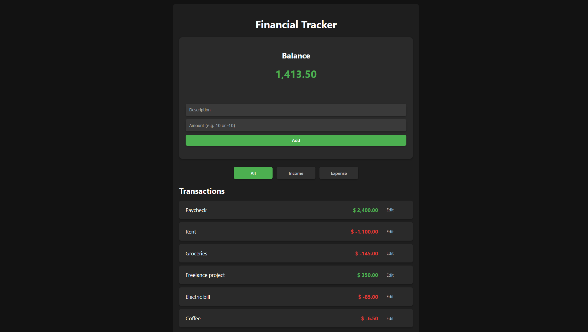
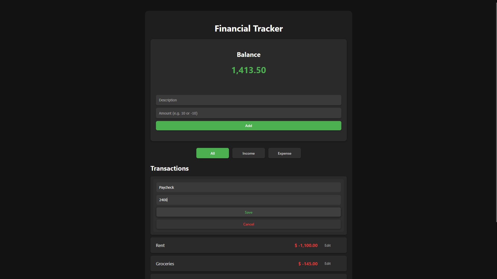

# Financial Tracker

A React app for tracking income and expenses. Add, edit, delete and filter transactions, and watch your balance update automatically. Your data is saved in the browser, so it's still there when you come back.

**Live demo:** https://fixedbits.github.io/financial-tracker/





## Features

- Add transactions with a description and an amount
- Edit or delete any transaction
- Filter the list by All, Income or Expense
- Balance updates automatically and turns red when negative
- Transactions are saved to localStorage and restored on reload
- Animated list items for adding and removing transactions

## Tech Stack

- React (hooks: useState, useEffect, useRef)
- Vite
- Framer Motion
- CSS

## How to Use

1. Type a description and an amount, then click **Add**.
2. Use a negative number for an expense, like -25. Positive numbers count as income.
3. Click **Edit** to change a transaction, then **Save** or **Cancel**.
4. Click the **x** to delete a transaction.
5. Use the **All**, **Income** and **Expense** buttons to filter the list.

## Run Locally

```bash
git clone https://github.com/FixedBits/financial-tracker.git
cd financial-tracker
npm install
npm run dev
```

Then open the local URL shown in your terminal.

## Notes

This is a front-end only project with no backend. Data is stored in your browser, so clearing site data will remove your transactions.

## Author

Built by [FixedBits](https://github.com/FixedBits)
